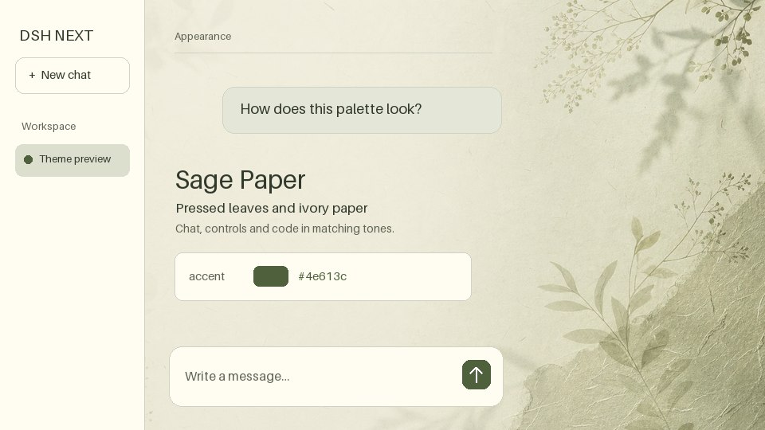
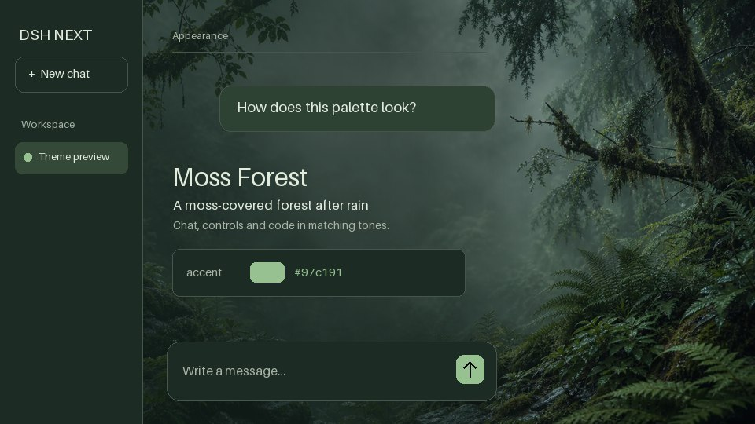
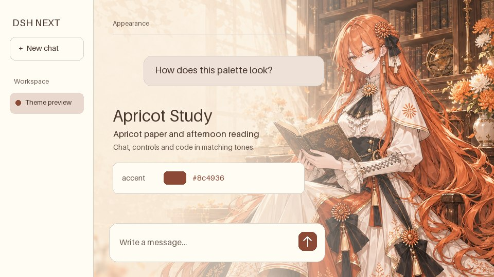
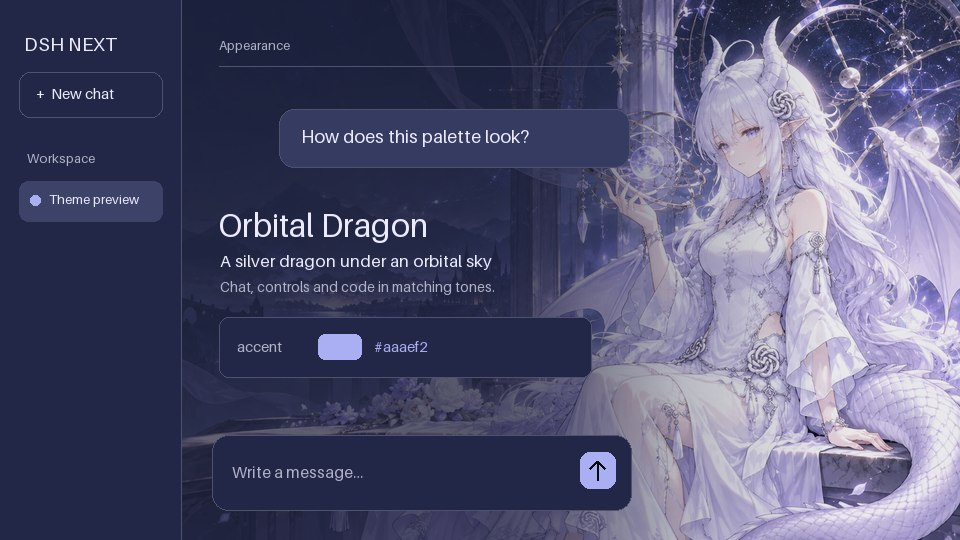

# Piora Themes for DSH NEXT

14 款来自 [Piora](https://github.com/kexijiang/pi-desktop) 的 DSH NEXT 主题，包含 8 款场景和 6 款角色。安装后由 **皮肤中心 v2** 管理，支持试穿、应用和恢复。每款主题的亮暗模式共享一张壁纸，正文、侧栏、代码块、输入框和状态色随模式切换。

## 主题预览

| 鼠尾草纸艺 · 浅色 | 苔藓森林 · 深色 |
| :--: | :--: |
|  |  |
| **杏纸书房 · 浅色** | **星环龙庭 · 深色** |
|  |  |

图为皮肤卡片内的界面示意。每款皮肤随包附两张预览和 WebP 原图。

| 主题 | 配色 | 预览 |
| --- | --- | --- |
| 鼠尾草纸艺 | 奶油纸面、鼠尾草绿 | [浅](skins/piora-sage-paper/preview/light.jpg) · [深](skins/piora-sage-paper/preview/dark.jpg) |
| 苔藓森林 | 苔绿、岩石灰 | [浅](skins/piora-moss-forest/preview/light.jpg) · [深](skins/piora-moss-forest/preview/dark.jpg) |
| 极光玻璃 | 冰蓝玻璃、淡紫极光 | [浅](skins/piora-aurora-glass/preview/light.jpg) · [深](skins/piora-aurora-glass/preview/dark.jpg) |
| 午夜星云 | 星紫、深蓝 | [浅](skins/piora-midnight-nebula/preview/light.jpg) · [深](skins/piora-midnight-nebula/preview/dark.jpg) |
| 祥瑞云锦 | 宣纸金、朱砂红 | [浅](skins/piora-auspicious-cloud/preview/light.jpg) · [深](skins/piora-auspicious-cloud/preview/dark.jpg) |
| 赤月剑境 | 烟玫瑰、赤月红 | [浅](skins/piora-crimson-sword/preview/light.jpg) · [深](skins/piora-crimson-sword/preview/dark.jpg) |
| 青空放课后 | 晴空蓝、白云 | [浅](skins/piora-sky-campus/preview/light.jpg) · [深](skins/piora-sky-campus/preview/dark.jpg) |
| 雨夜霓虹 | 雨蓝、电光洋红 | [浅](skins/piora-neon-city/preview/light.jpg) · [深](skins/piora-neon-city/preview/dark.jpg) |
| 晴汐 · 鲸鱼娘 | 晴海蓝、珍珠白 | [浅](skins/piora-whale-tide/preview/light.jpg) · [深](skins/piora-whale-tide/preview/dark.jpg) |
| 深海夜航 · 鲸鱼娘 | 海青、深蓝 | [浅](skins/piora-whale-abyss/preview/light.jpg) · [深](skins/piora-whale-abyss/preview/dark.jpg) |
| 杏纸书房 · Claude 娘 | 杏纸、陶土 | [浅](skins/piora-claude-paper/preview/light.jpg) · [深](skins/piora-claude-paper/preview/dark.jpg) |
| 琥珀夜读 · Claude 娘 | 胡桃木、琥珀 | [浅](skins/piora-claude-lamp/preview/light.jpg) · [深](skins/piora-claude-lamp/preview/dark.jpg) |
| 白龙云庭 · GPT 娘 | 银白、浅丁香 | [浅](skins/piora-gpt-ivory/preview/light.jpg) · [深](skins/piora-gpt-ivory/preview/dark.jpg) |
| 星环龙庭 · GPT 娘 | 银河蓝紫、银灰 | [浅](skins/piora-gpt-orbit/preview/light.jpg) · [深](skins/piora-gpt-orbit/preview/dark.jpg) |

## 安装

需启用 [皮肤中心 v2](https://github.com/zhu1090093659/dsh-skins)。首发版以 DSH NEXT 2.0.24-next 和皮肤中心 0.4.21 的清单和资源路由为验证环境。

1. 在 [GitHub Releases](https://github.com/kexijiang/dsh-piora-themes/releases) 下载 `dsh-piora-themes-0.1.0.tgz`。
2. 用 DSH NEXT 的插件管理安装并启用该 bundle。使用命令行安装时可运行 `dsh plugin --profile desktop add /path/to/dsh-piora-themes-0.1.0.tgz`，然后在该 profile 启用 `dsh-piora-themes`。仅转发包管理命令的 CLI 需要把包名加入 profile 的 `package.json` 中的 `dsh.profile.bundles` 数组，再重载 profile。
3. 在 **设置 → 皮肤** 里点 **试穿** 或 **应用**。在 **设置 → 通用设置** 里切换亮暗模式。

插件启用时把皮肤写入皮肤中心的用户皮肤目录。若同 ID 皮肤已存在，插件会保留该目录。停用插件后可在皮肤中心卸载其皮肤。如果只需部署皮肤文件，解压发布包并把 `package/skins/` 下的各主题目录复制到皮肤中心用户皮肤目录。

## 设计参考

[Catppuccin for DSH](https://github.com/NoNameLeGo/dsh-catppuccin-theme) 通过独立配色与可选半透明表面让主题辨识度更高。[DSH Theme Center](https://github.com/dac114514/dsh-theme-center) 把卡片预览和快速切换放在一起。本插件沿用每款主题单独选择、应用前先看预览的做法，使用皮肤中心 v2 的原生卡片与本地资源。

## 开发和署名

`npm run check` 验证清单、原图哈希、亮暗预览及重复安装。修改 `scripts/themes.json` 后，用 `python -m pip install -r scripts/requirements.txt` 安装生成器依赖，再运行 `python scripts/generate.py` 更新 CSS 和预览。

代码、原创场景和角色图的使用条件见 [素材署名与许可](NOTICE.md)。
